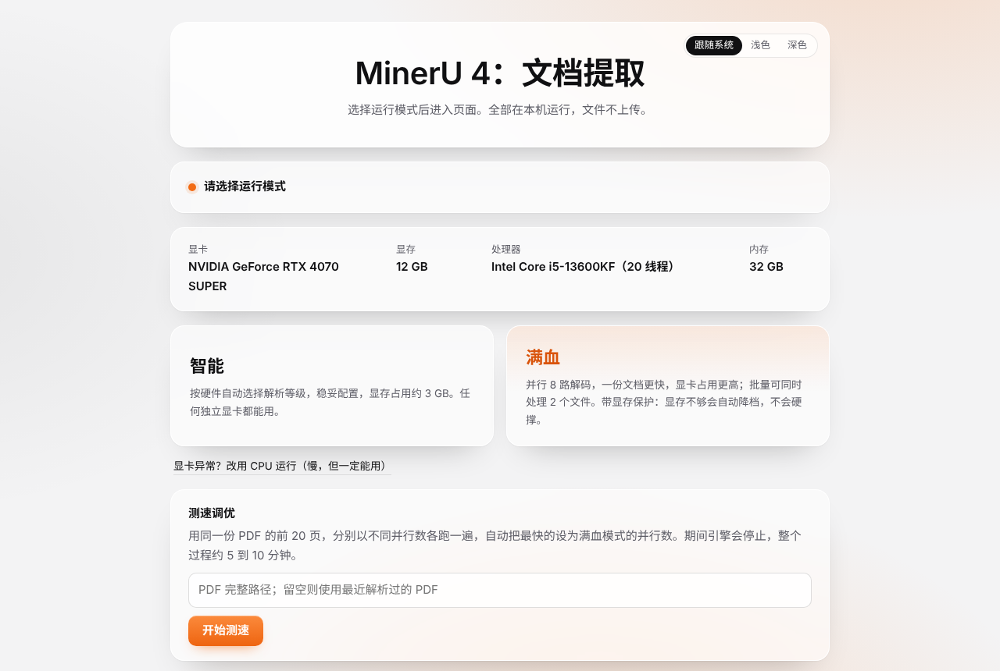
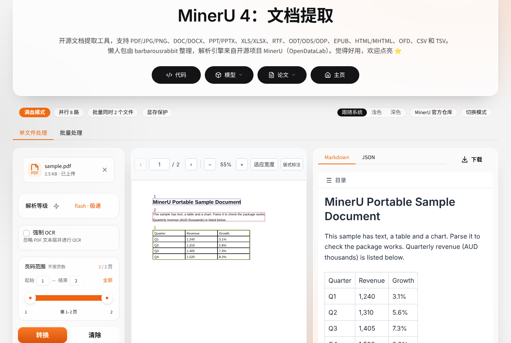
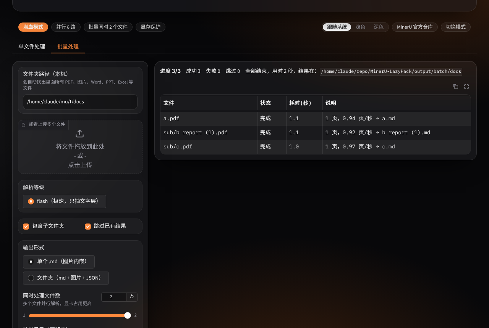

# MinerU 懒人包

把 PDF、图片、Word、PPT、Excel 转成 Markdown 的本地工具。一个文件夹，双击 `MinerU.bat` 就能用，全部在本机运行，文件不上传。

> 非官方整理。解析引擎是 OpenDataLab 的开源项目 [MinerU](https://github.com/opendatalab/MinerU)。本仓库只有启动、界面和打包脚本，不包含也不修改 MinerU 的源码。

## 它多做了什么

官方 MinerU 需要自己装 Python、装包、下模型、敲命令。这个懒人包在外面加了一层：

| 功能 | 说明 |
|---|---|
| 启动页 | 双击后先扫描硬件。没有可用独立显卡的电脑直接以 CPU 模式进入；有显卡的可以选「智能」或「满血」 |
| 单文件处理 | MinerU 官方界面，换了配色 |
| 批量处理 | 填一个文件夹路径或上传多个文件，自动找出所有文档逐个解析，输出目录结构与源文件夹一致，可停止、可续跑 |
| 满血模式 | 调高视觉模型的并行解码路数，批量可同时处理 2 个文件。需要 12 GB 以上显存 |
| 测速调优 | 用同一份 PDF 实测 4、8、12、16 路并行，自动采用最快的一档 |
| 显存保护 | 启动前按空闲显存自动降档；所有任务走同一个队列；引擎崩溃后以保守配置自动重启并重跑当前任务 |
| 外观 | 浅色和深色，默认跟随系统 |
| 局域网共享 | `MinerU-LAN.bat` 让同一网络下的其他设备用浏览器访问 |

## 怎么用

需要 Windows 10 或 11（64 位），约 3 GB 磁盘空间（打包给别人时另需约 5 GB）。安装过程要联网，之后可以离线使用。

1. 点页面上方的 Code，选 Download ZIP，解压到纯英文路径，例如 `D:\MinerU-LazyPack`。路径里有中文时视觉模型加载不了。
2. 双击 `build\setup.cmd`。它会在这个文件夹里装好 Python 3.12、MinerU 4.2.0 和模型（约 2 GB），走国内镜像，耗时取决于网速。
3. 双击 `MinerU.bat`，浏览器自动打开启动页。

关掉黑色窗口就停止服务并释放显存，没有后台进程。卸载就是删掉整个文件夹。

### 发给别人用

装好之后双击 `build\build.cmd`，会生成 `dist\MinerU-Portable.zip`（约 2 GB）。里面带了 Python 运行环境和模型，对方解压后双击 `MinerU.bat` 即可，不需要安装，也不需要联网。

## 三种模式

| 模式 | 什么时候出现 | 做什么 |
|---|---|---|
| CPU | 没有检测到可用的独立显卡时自动进入，也可以在显卡异常时手动选 | 默认用 basic 等级，慢，但一定能跑 |
| 智能 | 有显存 6 GB 以上的独立显卡 | MinerU 的默认配置，显存占用约 3 GB |
| 满血 | 独立显卡显存 12 GB 以上 | 并行解码路数更多，一份文档更快，显卡占用更高 |

是否算"可用显卡"沿用 MinerU 自己的判定。满血到底能快多少取决于机器，所以启动页带了测速。

## 显存保护是怎么回事

满血模式占用的显存更多，为了不被撑爆，做了三层：

1. **启动前量体裁衣。** 先读当前空闲显存，放不下设定的并行数就自动降档，连最低档都放不下就改用智能模式，并在启动页说明原因。
2. **统一排队。** 单文件、批量、局域网里其他人提交的任务都过同一道门。同时运行的任务数有上限，显存紧张时第二个任务排队等待。
3. **崩溃自愈。** 引擎进程如果因为显存耗尽而退出，会自动用保守配置重新启动，并把当前任务重跑一次。

限制：空闲显存是通过 `nvidia-smi` 读的，只有 NVIDIA 显卡能读到。AMD 和 Intel 显卡只按固定上限控制，第 3 层仍然有效。

## 文件说明

| 路径 | 用途 |
|---|---|
| `MinerU.bat` | 启动 |
| `MinerU-LAN.bat` | 以局域网共享方式启动。没有密码，只在可信网络使用 |
| `MinerU-WebUI.html` | 网页入口，服务开着时双击直接进界面 |
| `bin\launcher.py` | 启动页：硬件扫描、模式选择、测速 |
| `bin\webui_app.py` | 主页面：官方界面加批量页签、配色、显存保护 |
| `bin\server_boot.py` | 把并行路数传给 llama.cpp 引擎 |
| `bin\bench.py` | 测速脚本 |
| `tools\Drop-Files-Here.bat` | 不开网页，把文件拖到它上面直接出 Markdown |
| `tools\Self-Check.bat` | 自检：显卡识别、模型校验、版本 |
| `build\setup.cmd` | 安装运行环境和模型 |
| `build\build.cmd` | 打包成解压即用的整合包 |

`.bat` 和 `.cmd` 文件里的中文是 GBK 编码，在 GitHub 网页上显示成乱码是正常的，在中文版 Windows 上运行没有问题。

## 验证范围

在 Windows 11 加 NVIDIA RTX 50 系显卡上实测过安装、解析、打包。界面逻辑、硬件判定、排队和崩溃重启在无显卡环境下做过自动化测试。

纯 CPU 电脑、AMD 和 Intel 显卡走的是 MinerU 官方的自动选择逻辑，没有逐一实测。遇到问题欢迎提 Issue，请附上 `tools\Self-Check.bat` 的输出。

## 关于 MinerU 版本

安装脚本固定使用 MinerU 4.2.0。主页面的批量页签、配色和并行设置依赖这个版本的内部结构，换成其他版本时这些附加功能可能失效。失效时会自动退回官方原版界面，单文件解析不受影响。

## 致谢与许可

解析能力全部来自 [MinerU](https://github.com/opendatalab/MinerU)，版权归 OpenDataLab 及其贡献者所有，使用时请遵守 [MinerU Open Source License](https://github.com/opendatalab/MinerU/blob/master/LICENSE.md)。模型来自 [ModelScope 上的 OpenDataLab](https://modelscope.cn/organization/OpenDataLab)。

本项目与 OpenDataLab 没有隶属关系。
